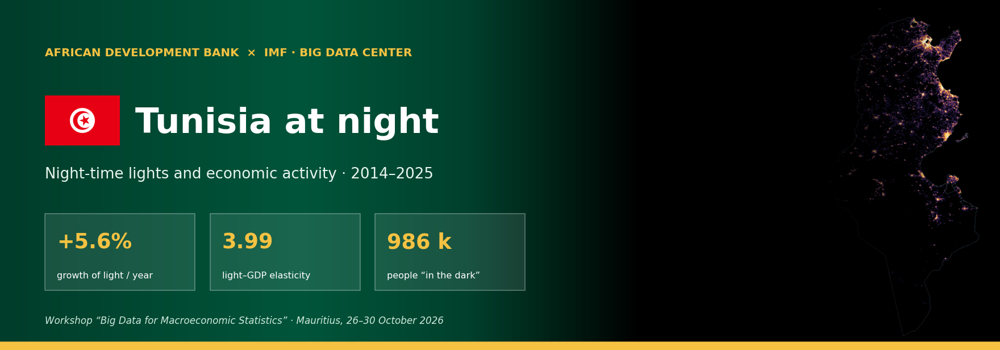
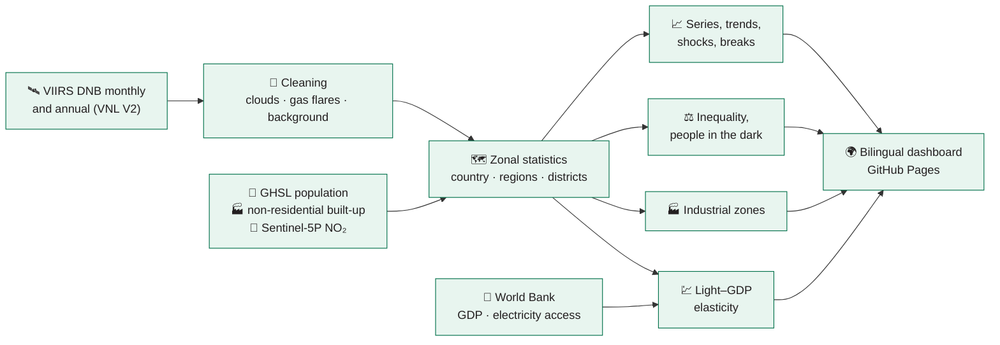

<!-- ntl-dashboard:auto — generated by the NTL hands-on part 3 notebook; edits will be overwritten -->

   

<b>Night-time lights and economic activity · 2014–2025</b> Workshop “Big Data for Macroeconomic Statistics” · Mauritius, 26–30 October 2026 <a href="README.md">Version française</a>

## 📊 At a glance

| Indicator | Value | Precision |
|---|---:|---|
| Annual growth of light | **+5.6%** | 2014–2025, robust slope (Theil–Sen) |
| Last 12 months vs previous 12 | **+3.8%** | seasonally adjusted series, up to 12/2025 |
| Light–GDP elasticity | **3.99** | 95% CI 0.98 to 7.00 · confidence medium |
| Gini of light per capita | **0.23** | ADM2 units, 2025 |
| People in the dark | **986 k** | 8% of the inhabited population, 2025 |
| Share of the top region | **10%** | Sfax, 2025 |

<a href="https://datainnov4africa-web.github.io/ntl-dashboard_exercise/en/"><b>➜ Open the dashboard</b></a>

## 💡 Key messages

1. **National trend** — Between 2014 and 2025, night-time light in Tunisia changed by +5.6% per year (95% CI: +4.7% to +6.2%). Over the last 12 months, the seasonally adjusted level is +3.8% relative to the previous 12 months.  
   🟢 high · significant trend (p < 0.01; n = 12)
2. **Regions** — Of 264 ADM2 units, 240 show significant growth, 23 are stagnating and 1 are declining. Light remains concentrated: Sfax accounts for 10% of national light.  
   🟠 medium · classification of 264 units, threshold ±1%/yr and p < 0.10
3. **Convergence** — Across ADM2 units, light per capita converges: the least-lit units are catching up.  
   🟠 medium · β = −0.038 [−0.047; −0.030], n = 264
4. **Link with GDP** — The elasticity of light with respect to real GDP is 3.99 in levels (95% CI: 0.98 to 7.00, R² = 0.54, 12 years) and 0.26 in growth rates (CI: −0.06 to 0.58). Out of sample, light growth tracks GDP growth with a correlation of −0.31 (mean absolute error: 3.0 percentage points of growth).  
   🟠 medium · n = 12, significant but wide CI (6.02)
5. **Shocks** — The most pronounced shock in the seasonally adjusted series is “COVID-19”: trough of -10.4% (11/2020), return to the pre-shock level after 10 months.  
   🟠 medium · trough compared with pre-shock month-to-month variability
6. **Inequality and access** — The Gini coefficient of light per capita (ADM2) is 0.23 in 2025 (significant decrease since 2014). About 0.99 million people live in inhabited areas with no detectable light (8% of the inhabited population).  
   🟠 medium · sensitive to the radiance threshold (from 0.98 to 1.58 M depending on the threshold); a proxy for outdoor lighting, not for grid connection
7. **Industrial zones** — 111 candidate industrial zones are detected (7 major hubs, 28 energy sites), covering 222 km². They emit 7% of national light; the largest is Cité El Khadra (Tunis). Their light changes by -0.3% per year.  
   🟠 medium · 79% of zones confirmed by OpenStreetMap; candidates to be checked

## 🛰️ Day and night

The country's main economic pole (Sfax Sud (Sfax)), by day as seen by Sentinel-2 and by night as seen by VIIRS. What the satellite sees at night — the lighting of cities, ports, factories and roads — is the proxy of activity used throughout this project.

## 🌃 What changed

VIIRS VNL V2 annual composites (gas flares masked), same logarithmic scale: left 2014, right 2025.

## 📈 The trend

The seasonally adjusted curve removes seasonal effects (snow, vegetation, festivities): read it to judge a rise or a fall.

## 🏭 Industrial zones

Industrial sites shine at night like towns, but their buildings are mostly non-residential, few people live there and they emit NO₂. Combining VIIRS, GHSL (non-residential built-up, population) and Sentinel-5P, **111 candidate zones** are detected; they emit **7%** of national light. 79% of them contain an industrial area mapped in OpenStreetMap (± 1 km).

| # | Zone | Type | Area | Share of national light | Growth / yr |
|---:|---|---|---:|---:|---:|
| 1 | Cité El Khadra (Tunis) | Energy / extraction site | 41.3 km² | 2.1% | +1.3% |
| 2 | Megrine (Ben Arous) | Major industrial hub | 8.3 km² | 0.4% | +1.1% |
| 3 | Radès (Ben Arous) | Major industrial hub | 7.9 km² | 0.4% | +0.5% |
| 4 | Remada (Tataouine) | Energy / extraction site | 2.7 km² | 0.3% | +89.2% |
| 5 | Gabes Medina (Gabès) | Major industrial hub | 6.4 km² | 0.3% | +4.1% |
| 6 | Dhehiba (Tataouine) | Energy / extraction site | 4.4 km² | 0.2% | -7.6% |
| 7 | Remada (Tataouine) | Major industrial hub | 5.1 km² | 0.2% | -3.8% |
| 8 | El Kabaria (Tunis) | Major industrial hub | 5.2 km² | 0.2% | +0.8% |

## ⚙️ How it is computed

Processing chain run on Google Earth Engine from the *NTL hands-on part 3* notebook:

## 📚 Data and licences

| Dataset | Producer | Licence |
|---|---|---|
| VIIRS DNB VNL V2 and monthly VCMSLCFG | NOAA / Earth Observation Group | public domain, citation requested |
| NASA Black Marble VNP46A2 | NASA | public domain |
| GHSL GHS-POP, GHS-BUILT-S, GHS-SMOD R2023A | European Commission, JRC | CC BY 4.0 |
| Sentinel-2 L2A, Sentinel-5P TROPOMI NO₂ | ESA / Copernicus | Copernicus licence (free) |
| geoBoundaries administrative boundaries | William & Mary geoLab | CC BY 4.0 |
| World Development Indicators | World Bank | CC BY 4.0 |
| Industrial areas (validation) | OpenStreetMap | ODbL |

## 🗂️ Repository layout

- `main` — this page: presentation, illustrations (`docs/img/`), licence, citation
- `gh-pages` — the published site: `index.html`, `assets/`, `data/<ISO3>/` (every table downloadable), French version in `fr/`

## 🔁 Reproduce or adapt to another country

The site is produced by the **NTL hands-on part 3** notebook (Colab). Changing the `ISO3` code in the parameters cell is enough to analyse another country; sections 12 and 13 export and re-publish this repository.

## 🤝 Credits and citation

Produced for the **“Big Data for Macroeconomic Statistics”** workshop organised by the **African Development Bank** with the **IMF Big Data Center**, hosted by **ATI** (Mauritius, 26–30 October 2026). Estimates are experimental and are not official statistics.

**Suggested citation** — African Development Bank & IMF Big Data Center (2026). *Night-time lights and economic activity · 2014–2025 — Tunisia*. https://datainnov4africa-web.github.io/ntl-dashboard_exercise/en/

Last update: 2026-10-16 · datainnov4africa-web/ntl-dashboard_exercise
