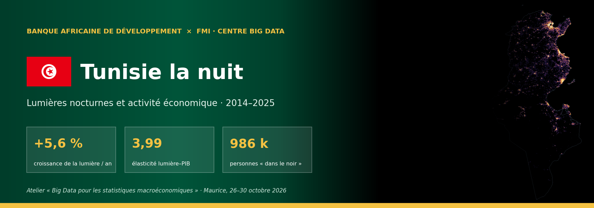
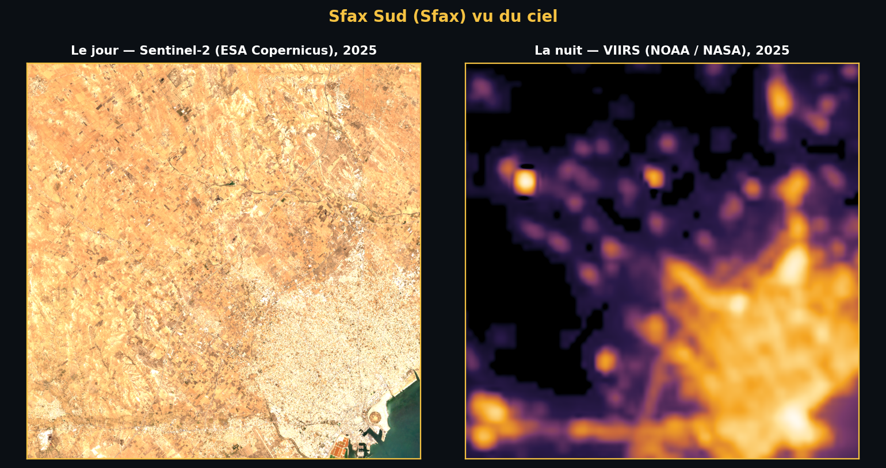
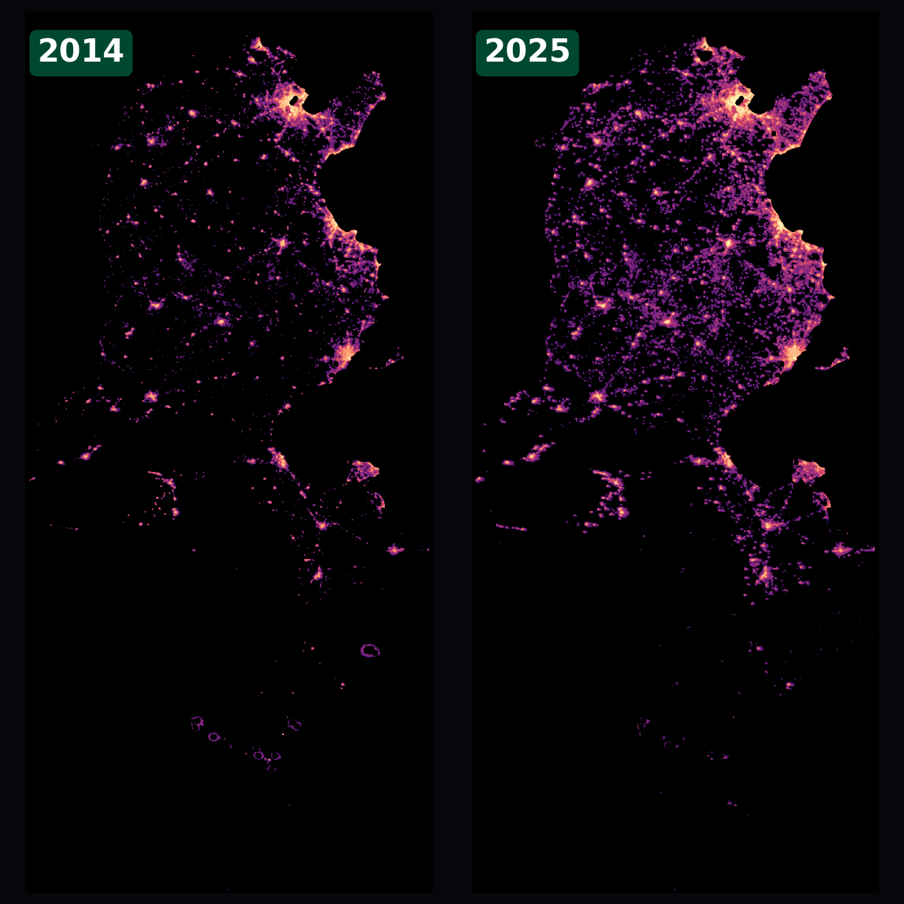
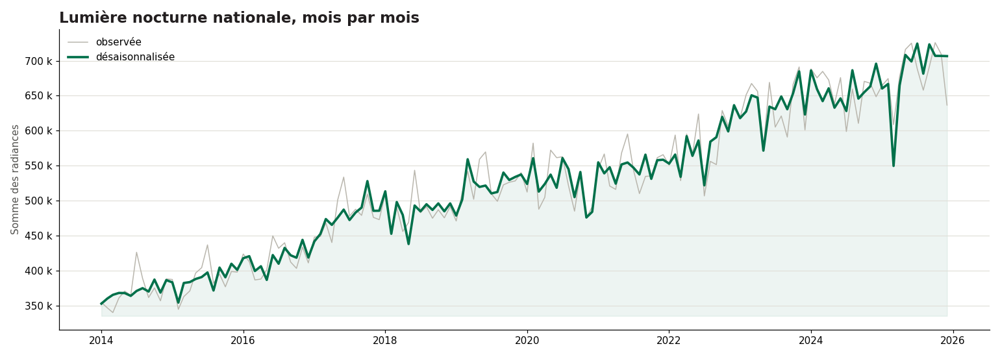
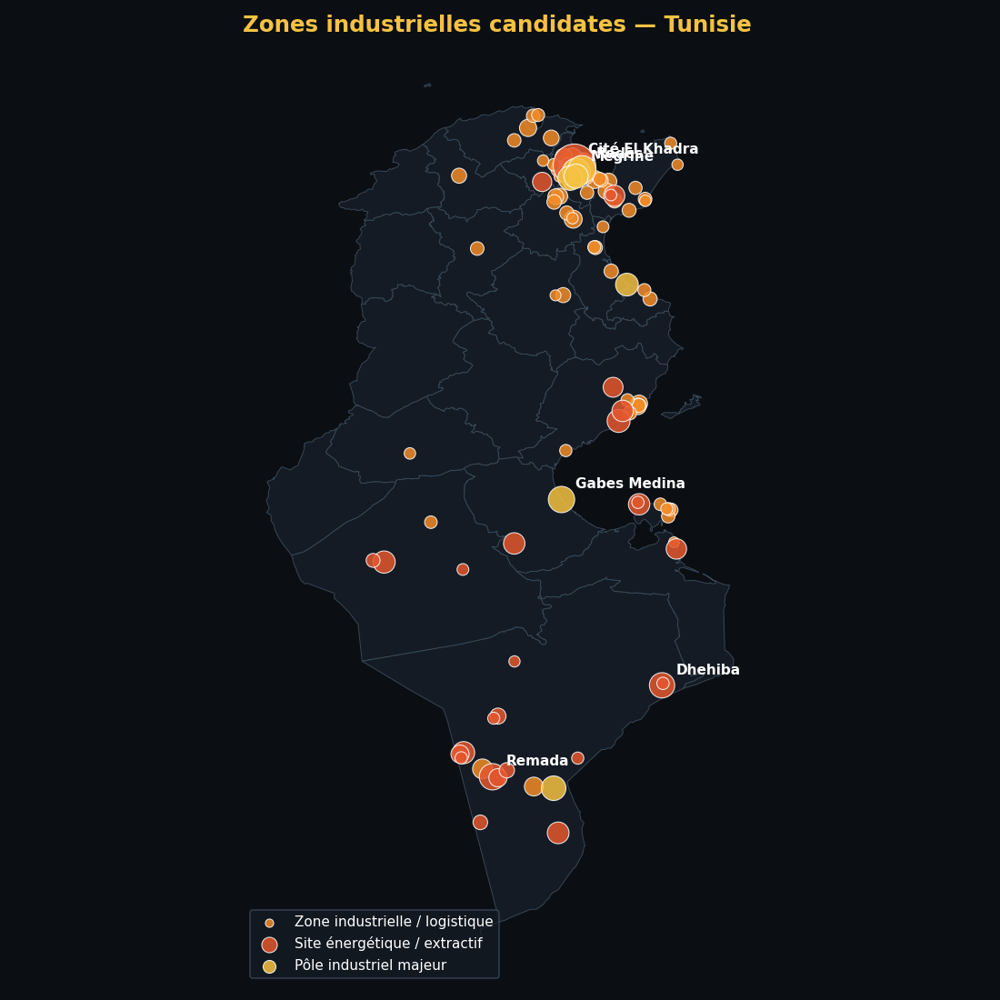
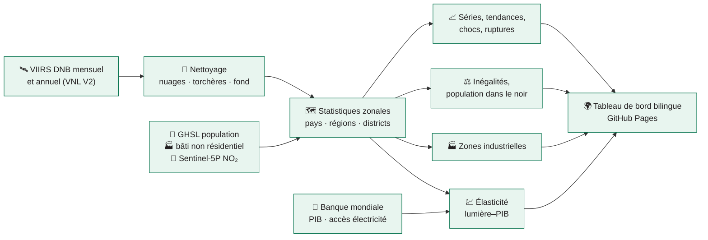

<!-- ntl-dashboard:auto — generated by the NTL hands-on part 3 notebook; edits will be overwritten -->

   

<b>Lumières nocturnes et activité économique · 2014–2025</b> Atelier « Big Data pour les statistiques macroéconomiques » · Maurice, 26–30 octobre 2026 <a href="README.en.md">English version</a>

## 📊 En bref

| Indicateur | Valeur | Précision |
|---|---:|---|
| Croissance annuelle de la lumière | **+5,6 %** | 2014–2025, pente robuste (Theil–Sen) |
| 12 derniers mois vs 12 précédents | **+3,8 %** | série désaisonnalisée, jusqu'à 12/2025 |
| Élasticité lumière–PIB | **3,99** | IC 95 % 0,98 à 7,00 · confiance moyenne |
| Gini de la lumière par habitant | **0,23** | unités ADM2, 2025 |
| Personnes dans le noir | **986 k** | 8 % de la population habitée, 2025 |
| Part de la 1ʳᵉ région | **10 %** | Sfax, 2025 |

<a href="https://datainnov4africa-web.github.io/ntl-dashboard_exercise/"><b>➜ Ouvrir le tableau de bord</b></a>

## 💡 Messages clés

1. **Tendance nationale** — Entre 2014 et 2025, la lumière nocturne de Tunisie a évolué de +5,6 % par an (IC 95 % : +4,7 % à +6,2 %). Sur les 12 derniers mois, le niveau désaisonnalisé est +3,8 % par rapport aux 12 mois précédents.  
   🟢 élevée · tendance significative (p < 0,01 ; n = 12)
2. **Régions** — Sur 264 unités ADM2, 240 sont en croissance significative, 23 stagnent et 1 déclinent. L'activité lumineuse reste concentrée : Sfax concentre 10 % de la lumière nationale.  
   🟠 moyenne · classement sur 264 unités, seuil ±1 %/an et p < 0,10
3. **Convergence** — Entre unités ADM2, la lumière par habitant converge : les unités les moins éclairées rattrapent leur retard.  
   🟠 moyenne · β = −0,038 [−0,047 ; −0,030], n = 264
4. **Lien avec le PIB** — L'élasticité de la lumière au PIB réel est de 3,99 en niveaux (IC 95 % : 0,98 à 7,00, R² = 0,54, 12 années) et de 0,26 en taux de croissance (IC : −0,06 à 0,58). Hors échantillon, la croissance des lumières suit celle du PIB avec une corrélation de −0,31 (erreur absolue moyenne : 3,0 point de croissance).  
   🟠 moyenne · n = 12, significatif mais IC large (6.02)
5. **Chocs** — Le choc le plus marqué dans la série désaisonnalisée est « COVID-19 » : creux de -10,4 % (11/2020), retour au niveau d'avant-choc après 10 mois.  
   🟠 moyenne · creux comparé à la variabilité mensuelle d'avant-choc
6. **Inégalités et accès** — Le Gini de la lumière par habitant (ADM2) vaut 0,23 en 2025 (baisse significative depuis 2014). Environ 0,99 million(s) de personnes vivent dans des zones habitées sans lumière détectable (8 % de la population habitée).  
   🟠 moyenne · sensible au seuil de radiance (de 0,98 à 1,58 M selon le seuil) ; proxy d'éclairage extérieur, pas de raccordement
7. **Zones industrielles** — 111 zones industrielles candidates sont détectées (7 pôles majeurs, 28 sites énergétiques), sur 222 km². Elles émettent 7 % de la lumière nationale ; la première est Cité El Khadra (Tunis). Leur lumière évolue de -0,3 % par an.  
   🟠 moyenne · 79 % des zones confirmées par OpenStreetMap ; candidats à vérifier

## 🛰️ Le jour et la nuit

Le principal pôle économique du pays (Sfax Sud (Sfax)), le jour vu par Sentinel-2 et la nuit vu par VIIRS. Ce que le satellite voit la nuit — l'éclairage des villes, des ports, des usines et des routes — est l'indicateur indirect d'activité utilisé dans tout ce projet.

## 🌃 Ce qui a changé

Composites annuels VIIRS VNL V2 (torchères masquées), même échelle logarithmique : à gauche 2014, à droite 2025.

## 📈 La tendance

La courbe désaisonnalisée retire les effets de saison (neige, végétation, fêtes) : c'est elle qu'il faut lire pour juger d'une hausse ou d'une baisse.

## 🏭 Zones industrielles

Les sites industriels brillent la nuit comme les villes, mais leurs bâtiments sont surtout non résidentiels, peu de gens y habitent et ils émettent du NO₂. En combinant VIIRS, GHSL (bâti non résidentiel, population) et Sentinel-5P, **111 zones candidates** sont détectées ; elles émettent **7 %** de la lumière nationale. 79 % d'entre elles contiennent une zone industrielle répertoriée dans OpenStreetMap (± 1 km).

| # | Zone | Type | Surface | Part de la lumière nationale | Croissance / an |
|---:|---|---|---:|---:|---:|
| 1 | Cité El Khadra (Tunis) | Site énergétique / extractif | 41,3 km² | 2,1 % | +1,3 % |
| 2 | Megrine (Ben Arous) | Pôle industriel majeur | 8,3 km² | 0,4 % | +1,1 % |
| 3 | Radès (Ben Arous) | Pôle industriel majeur | 7,9 km² | 0,4 % | +0,5 % |
| 4 | Remada (Tataouine) | Site énergétique / extractif | 2,7 km² | 0,3 % | +89,2 % |
| 5 | Gabes Medina (Gabès) | Pôle industriel majeur | 6,4 km² | 0,3 % | +4,1 % |
| 6 | Dhehiba (Tataouine) | Site énergétique / extractif | 4,4 km² | 0,2 % | -7,6 % |
| 7 | Remada (Tataouine) | Pôle industriel majeur | 5,1 km² | 0,2 % | -3,8 % |
| 8 | El Kabaria (Tunis) | Pôle industriel majeur | 5,2 km² | 0,2 % | +0,8 % |

## ⚙️ Comment c'est calculé

Chaîne de traitement exécutée dans Google Earth Engine depuis le notebook *NTL hands-on part 3* :

## 📚 Données et licences

| Donnée | Producteur | Licence |
|---|---|---|
| VIIRS DNB VNL V2 et mensuel VCMSLCFG | NOAA / Earth Observation Group | domaine public, citation demandée |
| NASA Black Marble VNP46A2 | NASA | domaine public |
| GHSL GHS-POP, GHS-BUILT-S, GHS-SMOD R2023A | Commission européenne, JRC | CC BY 4.0 |
| Sentinel-2 L2A, Sentinel-5P TROPOMI NO₂ | ESA / Copernicus | licence Copernicus (libre) |
| Limites administratives geoBoundaries | William & Mary geoLab | CC BY 4.0 |
| Indicateurs du développement (WDI) | Banque mondiale | CC BY 4.0 |
| Zones industrielles (validation) | OpenStreetMap | ODbL |

## 🗂️ Organisation du dépôt

- `main` — cette page : présentation, illustrations (`docs/img/`), licence, citation
- `gh-pages` — le site publié : `index.html`, `assets/`, `data/<ISO3>/` (toutes les tables téléchargeables), version anglaise dans `en/`

## 🔁 Reproduire ou adapter à un autre pays

Le site est produit par le notebook **NTL hands-on part 3** (Colab). Changer le code `ISO3` dans la cellule de paramètres suffit pour analyser un autre pays ; les sections 12 et 13 exportent puis republient ce dépôt.

## 🤝 Crédits et citation

Réalisé pour l'atelier **« Big Data pour les statistiques macroéconomiques »** organisé par la **Banque africaine de développement** avec le **Centre Big Data du FMI**, accueilli par l'**ATI** (Maurice, 26–30 octobre 2026). Les estimations sont expérimentales et ne constituent pas des statistiques officielles.

**Citation suggérée** — Banque africaine de développement & Centre Big Data du FMI (2026). *Lumières nocturnes et activité économique · 2014–2025 — Tunisie*. https://datainnov4africa-web.github.io/ntl-dashboard_exercise/

Dernière mise à jour : 2026-10-16 · datainnov4africa-web/ntl-dashboard_exercise
